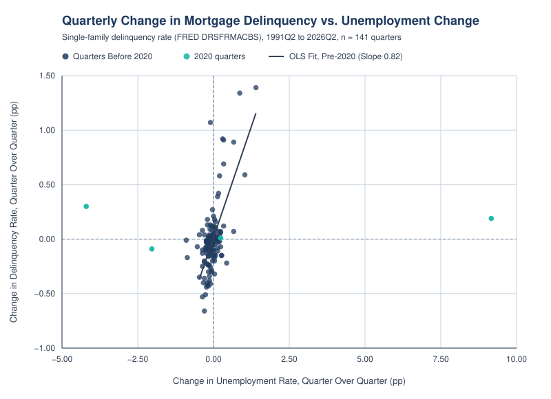
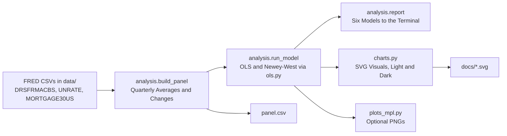
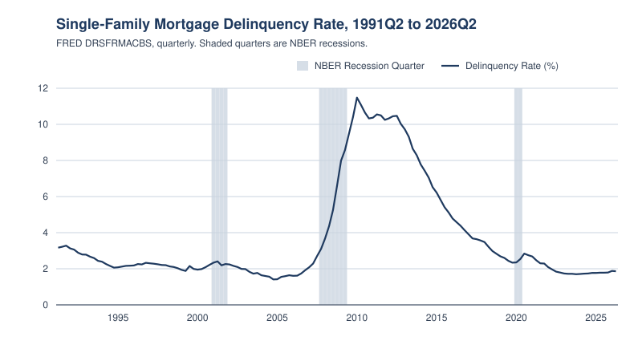
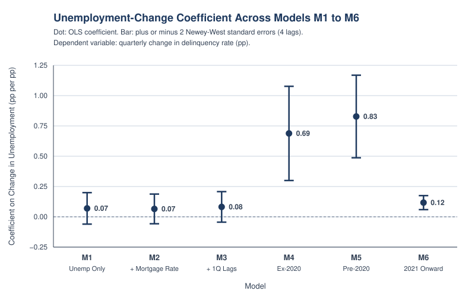
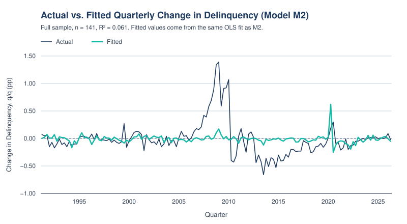
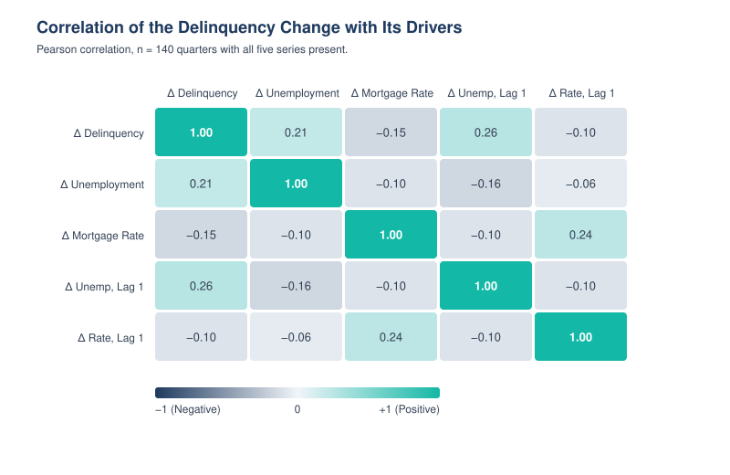
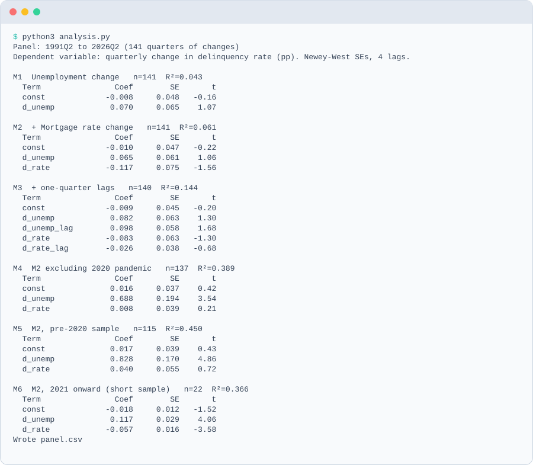

<picture>
  <source media="(prefers-color-scheme: dark)" srcset="docs/banner-dark.svg">
  
</picture>

   

Do changes in unemployment and mortgage rates explain quarterly changes in the U.S. single-family mortgage delinquency rate? This project builds a quarterly panel from public FRED data (1991–2026), fits OLS models with Newey-West standard errors, and tests how the answer changes across sample windows. Pure Python, standard library only.

## Contents

- [Hero Chart](#hero-chart)
- [Results at a Glance](#results-at-a-glance)
- [How It Works](#how-it-works)
- [Quickstart](#quickstart)
- [Charts](#charts)
- [Sample Output](#sample-output)
- [Methodology](#methodology)
- [Optional Matplotlib Plots](#optional-matplotlib-plots)
- [Skills Shown](#skills-shown)
- [Limitations](#limitations)
- [Project Layout, Data and License](#project-layout-data-and-license)
- [Glossary](#glossary)

## Hero Chart

<picture>
  <source media="(prefers-color-scheme: dark)" srcset="docs/delinquency_vs_unemployment-dark.svg">
  
</picture>

## Results at a Glance

| Quantity | Value | Model |
|---|---|---|
| Δ Unemployment Coefficient, Pre-2020 Sample | 0.83 pp per pp (t = 4.86) | M5 |
| Δ Unemployment Coefficient, All 141 Quarters | 0.07 pp per pp (t = 1.07) | M1 |
| Δ Unemployment Coefficient, Excluding 2020 | 0.69 pp per pp (t = 3.54) | M4 |
| Δ Mortgage Rate Coefficient, All 141 Quarters | −0.12 pp per pp (t = −1.56) | M2 |
| R², Pre-2020 Sample | 0.450 (n = 115) | M5 |

- **Unemployment is a strong, stable predictor outside 2020.** Before 2020, a 1 percentage point rise in the quarter's unemployment rate (versus the prior quarter) goes with a **0.83 pp larger quarterly rise** in the delinquency rate (t ≈ 4.9, R² 0.45, n = 115).
- **The full-sample result is weak because of 2020.** Using all 141 quarters, the same coefficient falls to about 0.07 (t ≈ 1.1). Dropping only the four 2020 quarters restores it to 0.69 (t ≈ 3.5). The data don't say why, though forbearance is a plausible candidate.
- **Mortgage rate changes add little.** The rate coefficient is insignificant in every model except a 22-quarter sample from 2021 onward, where Newey-West standard errors are unreliable, so I treat that result as suggestive only.

These are associations, not causal estimates.

<details>
<summary>Full Model Tables</summary>

Coefficients with Newey-West t-statistics in parentheses. Bold marks |t| > 3.

| Model | Regressors | Sample | n | R² |
|---|---|---|---:|---:|
| M1 | Δ unemployment | 1991Q2–2026Q2 | 141 | 0.043 |
| M2 | Δ unemployment, Δ mortgage rate | 1991Q2–2026Q2 | 141 | 0.061 |
| M3 | M2 plus one-quarter lags | 1991Q2–2026Q2 | 140 | 0.144 |
| M4 | M2, excluding 2020Q1–2020Q4 | 1991Q2–2026Q2 | 137 | 0.389 |
| M5 | M2 | 1991Q2–2019Q4 | 115 | 0.450 |
| M6 | M2 | 2021Q1–2026Q2 | 22 | 0.366 |

| Term | M1 | M2 | M3 | M4 | M5 | M6 |
|---|---:|---:|---:|---:|---:|---:|
| Δ unemployment | 0.070 (1.07) | 0.065 (1.06) | 0.082 (1.30) | **0.688 (3.54)** | **0.828 (4.86)** | **0.117 (4.06)** |
| Δ mortgage rate | | −0.117 (−1.56) | −0.083 (−1.30) | 0.008 (0.21) | 0.040 (0.72) | **−0.057 (−3.58)** |
| Δ unemployment, lag 1 | | | 0.098 (1.68) | | | |
| Δ mortgage rate, lag 1 | | | −0.026 (−0.68) | | | |

</details>

## How It Works



## Quickstart

```bash
python3 analysis.py            # prints the six models and writes panel.csv
python3 -m unittest discover   # runs the test suite
python3 charts.py              # regenerates every SVG in docs/ (light and dark)
python3 fetch_fred.py          # optional: refresh data/ from FRED (no API key)

pip install -r requirements-extra.txt   # optional extra
python3 plots_mpl.py                    # optional PNGs in docs/mpl/
```

Requires Python 3.9 or later. The core needs no third-party packages.

## Charts

**Delinquency Rate Over Time.** The level of the single-family delinquency rate since 1991, with NBER recession quarters shaded. Recession dates are hardcoded in `charts.py`, not pulled from FRED.

<picture>
  <source media="(prefers-color-scheme: dark)" srcset="docs/delinquency_over_time-dark.svg">
  
</picture>

**Coefficient Comparison Across Models.** The unemployment-change coefficient in M1 to M6, with bars spanning plus or minus 2 Newey-West standard errors. The spread across samples is the main result.

<picture>
  <source media="(prefers-color-scheme: dark)" srcset="docs/coefficients-dark.svg">
  
</picture>

**Actual vs. Fitted.** Model M2 over the full sample. The fit is loose (R² 0.061), so the model explains little of the quarter-to-quarter noise, and the 2020 spike is missed.

<picture>
  <source media="(prefers-color-scheme: dark)" srcset="docs/actual_vs_fitted-dark.svg">
  
</picture>

**Driver Correlations.** Pearson correlations among the delinquency change and its drivers, over the 140 quarters where the lagged terms exist. Correlations are modest, which fits the weak full-sample fit.

<picture>
  <source media="(prefers-color-scheme: dark)" srcset="docs/driver_correlations-dark.svg">
  
</picture>

## Sample Output

<picture>
  <source media="(prefers-color-scheme: dark)" srcset="docs/sample-output-dark.svg">
  
</picture>

<details>
<summary>Full Output</summary>

```text
Panel: 1991Q2 to 2026Q2 (141 quarters of changes)
Dependent variable: quarterly change in delinquency rate (pp). Newey-West SEs, 4 lags.

M1  Unemployment change   n=141  R²=0.043
  Term                Coef        SE       t
  const             -0.008     0.048   -0.16
  d_unemp            0.070     0.065    1.07

M2  + Mortgage rate change   n=141  R²=0.061
  Term                Coef        SE       t
  const             -0.010     0.047   -0.22
  d_unemp            0.065     0.061    1.06
  d_rate            -0.117     0.075   -1.56

M3  + one-quarter lags   n=140  R²=0.144
  Term                Coef        SE       t
  const             -0.009     0.045   -0.20
  d_unemp            0.082     0.063    1.30
  d_unemp_lag        0.098     0.058    1.68
  d_rate            -0.083     0.063   -1.30
  d_rate_lag        -0.026     0.038   -0.68

M4  M2 excluding 2020 pandemic   n=137  R²=0.389
  Term                Coef        SE       t
  const              0.016     0.037    0.42
  d_unemp            0.688     0.194    3.54
  d_rate             0.008     0.039    0.21

M5  M2, pre-2020 sample   n=115  R²=0.450
  Term                Coef        SE       t
  const              0.017     0.039    0.43
  d_unemp            0.828     0.170    4.86
  d_rate             0.040     0.055    0.72

M6  M2, 2021 onward (short sample)   n=22  R²=0.366
  Term                Coef        SE       t
  const             -0.018     0.012   -1.52
  d_unemp            0.117     0.029    4.06
  d_rate            -0.057     0.016   -3.58

Wrote panel.csv
```

</details>

## Methodology

The dependent variable is the quarterly change in the delinquency rate, $\Delta y_t = y_t - y_{t-1}$, in percentage points. Regressors are quarterly changes in the unemployment rate and the mortgage rate (plus one-quarter lags in M3). Each quarter's unemployment and mortgage rate is the average of its months or weeks.

**Estimator.** OLS from the normal equations:

$$\hat\beta = (X^\top X)^{-1} X^\top y$$

**Newey-West Standard Errors.** With score $s_t = x_t e_t$ and 4 lags, the long-run covariance uses Bartlett weights $w_\ell = 1 - \frac{\ell}{5}$:

$$\hat S = \sum_t s_t s_t^\top + \sum_{\ell=1}^{4} w_\ell \sum_t \left(s_t s_{t-\ell}^\top + s_{t-\ell} s_t^\top\right)$$

$$\widehat{\mathrm{Var}}(\hat\beta) = (X^\top X)^{-1}\, \hat S\, (X^\top X)^{-1}$$

Lag products pair only observations exactly $\ell$ quarters apart, so models that drop quarters (M4 to M6) do not bridge the gaps.

**Fit.** $$R^2 = 1 - \frac{\sum_t e_t^2}{\sum_t (y_t - \bar y)^2}$$

## Optional Matplotlib Plots

The core is standard library only. `plots_mpl.py` is an optional extra that writes matplotlib versions of the main charts. It needs `matplotlib` from `requirements-extra.txt` and prints a short message if the package is missing. The generated PNGs are committed in `docs/mpl/`:

- [`delinquency_over_time.png`](docs/mpl/delinquency_over_time.png)
- [`delinquency_vs_unemployment.png`](docs/mpl/delinquency_vs_unemployment.png)
- [`coefficients.png`](docs/mpl/coefficients.png)
- [`actual_vs_fitted.png`](docs/mpl/actual_vs_fitted.png)
- [`driver_correlations.png`](docs/mpl/driver_correlations.png)

## Skills Shown

Python · Econometrics · Time Series · Data Visualization

## Limitations

- **Associations, not causes.** Unemployment, rates, and delinquency all respond to the same economic conditions.
- **Few independent episodes.** About 140 quarters contain only a handful of recessions, so a few episodes can drive the estimates. M6 has 22 quarters, which is too short for reliable Newey-West errors.
- **Quarterly averages smooth within-quarter timing,** so the lag structure is approximate.
- **Bank-held loans only.** The delinquency series covers loans held by commercial banks. It is not the agency (government-sponsored enterprise) book, so the findings should not be read as a statement about agency pools.
- **Revisions.** FRED series can be revised, and the latest delinquency quarter is published with a lag.
- **Recession bands are hardcoded.** The NBER dates in `charts.py` are not read from a data file. They are quarter-level and used only for shading.
- **Synthetic test data.** The OLS unit tests use synthetic random data with known coefficients to check the math. The analysis itself runs only on the real FRED series in `data/`.

## Project Layout, Data and License

```
MortgageDelinquencyDrivers/
├── analysis.py              builds the quarterly panel, runs the six models, writes panel.csv
├── ols.py                   matrix inverse, OLS, Newey-West standard errors
├── charts.py                hand-written SVG visuals, light and dark
├── plots_mpl.py             optional matplotlib PNGs (needs requirements-extra.txt)
├── fetch_fred.py            downloads the three FRED series into data/
├── test_analysis.py         unit tests (19 pass; 1 matplotlib test skips without matplotlib)
├── requirements-extra.txt   optional matplotlib dependency
├── data/                    pinned FRED snapshot
├── docs/                    SVG visuals (light and -dark), sample output, docs/mpl/ PNGs
├── panel.csv                the quarterly panel behind the models
└── LICENSE
```

### Data

All series come from FRED, the Federal Reserve Bank of St. Louis, and are pinned in `data/` (fetched 2026-10-17). MORTGAGE30US is Freddie Mac's Primary Mortgage Market Survey (PMMS) series, distributed through FRED. Re-running `fetch_fred.py` pulls the latest data, and the numbers above will move with it.

| FRED ID | Series | Frequency | Quarterly Aggregation |
|---|---|---|---|
| `DRSFRMACBS` | Delinquency rate on single-family residential mortgages, booked in domestic offices, all commercial banks, seasonally adjusted | Quarterly | Quarter value |
| `UNRATE` | Civilian unemployment rate | Monthly | Quarter average |
| `MORTGAGE30US` | 30-year fixed mortgage rate (Freddie Mac PMMS) | Weekly | Quarter average |

The panel runs 1991Q2 to 2026Q2, giving 141 quarter-over-quarter changes.

### License

MIT. See [LICENSE](LICENSE).

## Glossary

| Term | Plain-English Meaning |
|---|---|
| Coefficient | The amount the result moves for a one-unit change in one input, with the other inputs held fixed. |
| Delinquency Rate | The share of home loans where the borrower is behind on payments. |
| Dependent Variable | The outcome a model is trying to explain, here the quarterly change in the delinquency rate. |
| Forbearance | A temporary arrangement where a lender lets a struggling borrower pause or reduce payments. |
| FRED | The Federal Reserve Bank of St. Louis's free database of economic data, used here as the source for every series. |
| Lag | The value of a measure from an earlier period, such as last quarter's unemployment change. |
| Mortgage Rate | The average interest rate on a 30-year fixed home loan, from the Freddie Mac weekly survey. |
| NBER Recession Dates | The official start and end dates of US recessions, set by the National Bureau of Economic Research. |
| Newey-West Standard Errors | Uncertainty estimates adjusted so they stay sound when one quarter's errors carry into the next. |
| OLS (Ordinary Least Squares) | A method that fits the straight line through the data that makes the total squared misses as small as possible. |
| Panel | A dataset with one row per time period, here one row per quarter. |
| Pearson Correlation | A score from -1 to +1 showing how closely two measures move together in a straight line. |
| Percentage Point (pp) | The gap between two percentages, so going from 5% to 6% is a rise of 1 percentage point. |
| R-Squared | The share of the ups and downs in the data that the model explains, from 0 (none) to 1 (all). |
| Regressor | An input variable used to explain the outcome, such as the unemployment change. |
| Revision | A later correction to a published number, so older data can change. |
| Standard Error | The typical size of the uncertainty around an estimate, like the margin of error in a poll. |
| t-Statistic | An estimate divided by its standard error; the larger the size, the less likely the result is just chance. |
| Unemployment Rate | The share of people in the labor force who are actively looking for work but have no job. |


---

Built by Hari Saravanan · [LinkedIn](https://www.linkedin.com/in/srihari-saravanan)
